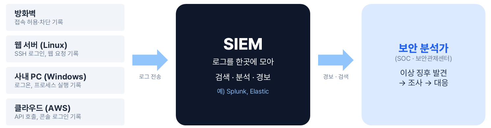
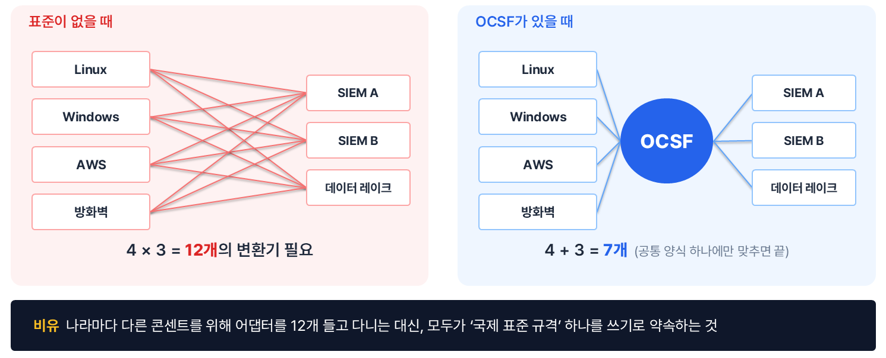
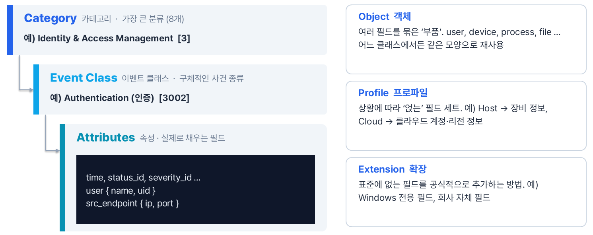
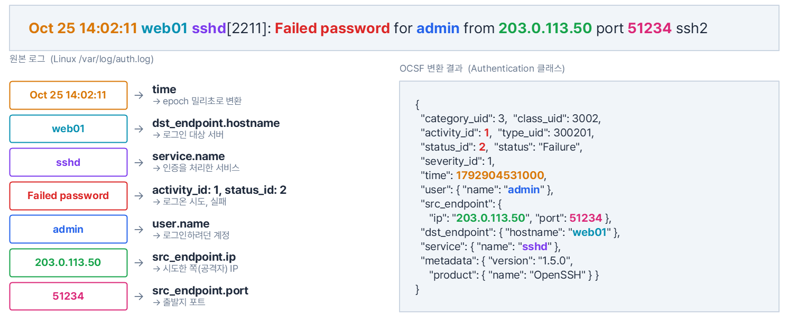
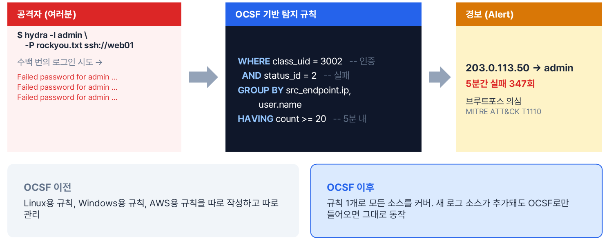

## 1. 블루팀은 무엇을 보고 일하나

### 1.1. 공격의 흔적, 로그
> "공격의 흔적은 어디에 남을까?"

- **로그**(Log)는 시스템이 남기는 행동 기록이다. '누가, 언제, 어디서, 무엇을' 했는지가 담긴다.
- 로그를 남기는 곳은 생각보다 많다.
    - 방화벽 → 접속 허용·차단 기록
    - 웹 서버(Linux) → SSH 로그인, 웹 요청 기록
    - 사내 PC(Windows) → 로그온, 프로세스 실행 기록
    - 클라우드(AWS) → API 호출, 콘솔 로그인 기록



### 1.2. SIEM과 SOC
- **SIEM**(Security Information & Event Management)은 여러 장비의 로그를 한곳에 모아 검색하고, 탐지 규칙을 돌려 경보를 띄우는 플랫폼이다. (예: Splunk, Elastic)
- **SOC**(Security Operations Center, 보안관제센터)의 분석가는 SIEM에서 경보를 받으면 조사하고 대응한다.
- 레드팀은 침투해서 약점을 증명하고, 블루팀은 남은 흔적을 보고 탐지·대응한다. 즉, 블루팀의 원재료는 로그다.

<br>

---

## 2. 문제 상황: 같은 사건, 세 가지 언어
- 상황: 공격자(`203.0.113.50`)가 admin 계정으로 로그인을 시도했다가 실패했다.
- 똑같은 사건인데, 시스템마다 기록하는 방식이 전혀 다르다.

#### Linux (/var/log/auth.log)
- 사람이 읽는 문장 한 줄로 남는다.

```text
Oct 25 14:02:11 web01 sshd[2211]: Failed password for admin from 203.0.113.50 port 51234 ssh2
```

#### Windows (보안 이벤트 4625)
- 이벤트 번호와 필드로 남는다.

```text
EventID: 4625 (An account failed to log on)
TargetUserName: admin
IpAddress: 203.0.113.50
LogonType: 3
```

#### AWS (CloudTrail)
- JSON으로 남는다.

```json
{
  "eventName": "ConsoleLogin",
  "sourceIPAddress": "203.0.113.50",
  "userIdentity": { "userName": "admin" },
  "responseElements": { "ConsoleLogin": "Failure" }
}
```

- 같은 의미의 정보를 비교해 보면 다음과 같다.

| 의미 | Linux | Windows | AWS |
|------|-------|---------|-----|
| 출발지 IP | 문장 속 "from …" | `IpAddress` | `sourceIPAddress` |
| 사용자 | 문장 속 "for admin" | `TargetUserName` | `userIdentity.userName` |
| 성공 / 실패 | "Failed password" | EventID 4625 (번호 자체가 실패) | `ConsoleLogin: "Failure"` |

- 출발지 IP 하나만 해도 필드 이름이 전부 다르고, Linux는 아예 필드가 없어서 문장을 잘라내야(파싱) 한다.
- '실패'를 표현하는 방식도 문장, 이벤트 번호, 문자열 값으로 제각각이다.

<br>

---

## 3. 왜 문제일까? 변환 지옥: N × M 문제
- 로그 소스가 N개, 이를 쓰는 분석 도구가 M개면 서로 맞추는 변환 작업이 **N × M개** 필요하다.
- 소스가 하나 늘 때마다 모든 도구 쪽 작업이 함께 늘어난다. 실무에서 흔히 말하는 '파싱/정규화 지옥'이다.
- 가운데에 모두가 따르는 공통 양식을 두면, 소스는 그 양식으로만 내보내고 도구는 그 양식만 읽으면 된다. 변환 작업이 **N + M개**로 줄어든다.



> 나라마다 다른 콘센트를 위해 어댑터를 12개 들고 다니는 대신, 모두가 '국제 표준 규격' 하나를 쓰기로 약속하는 것과 같다.

- 이 공통 양식이 바로 OCSF다.

<br>

---

## 4. OCSF란?

- OCSF는 **Open Cybersecurity Schema Framework**의 약자다.
- 보안 이벤트를 '어떤 필드 이름'과 '어떤 값 형식'으로 적을지 정해 둔 **벤더 중립 오픈 표준**이다.
- 스키마는 데이터의 '양식'이다.
    - 회원가입 폼이 '이름, 생년월일(YYYY-MM-DD), 이메일' 칸을 정해 두듯,
    - OCSF는 "로그인 이벤트라면 `user.name`, `src_endpoint.ip`, `status_id` … 를 이렇게 적어라"를 정해 둔다.

- 특징
    - 오픈소스: Apache 2.0 라이선스
    - 벤더 중립: 특정 회사 소유가 아니라서 경쟁사끼리도 같이 쓸 수 있다
    - 확장 가능: 표준을 깨지 않고 필요한 필드를 추가할 수 있다


| 시기 | 내용 |
|------|------|
| 2022.08 | Black Hat에서 출범. AWS · Splunk 주도, Cisco · IBM 등 참여. Symantec(Broadcom)의 스키마를 바탕으로 시작 |
| 2023.08 | Black Hat 2023에서 v1.0 정식 발표 |
| 2024.11 | Linux Foundation 프로젝트로 합류. 기여자 900명+, 참여 조직 200곳+ (발표 당시 기준) |
| 현재 | Amazon Security Lake의 기본 데이터 형식, Splunk 등 여러 보안 제품이 지원 |

<br>

---

## 5. OCSF의 구조

### 5.1. 카테고리 → 이벤트 클래스 → 속성
> "도서관 분류처럼 '큰 분류 → 작은 분류 → 세부 정보' 순으로 내려간다"

- **Category** (카테고리): 가장 큰 분류. 8개가 있다.
    - 예) Identity & Access Management `[3]`
- **Event Class** (이벤트 클래스): 구체적인 사건 종류.
    - 예) Authentication(인증) `[3002]`
- **Attributes** (속성): 실제로 채우는 필드.
    - 예) `time`, `status_id`, `severity_id`, `user { name, uid }`, `src_endpoint { ip, port }`
    - 클래스마다 채워야 할 필드가 정해져 있고, 필수(Required) / 권장(Recommended) / 선택(Optional) 등급이 있다.



### 5.2. Object, Profile, Extension
- **Object** (객체)
    - 여러 필드를 묶은 '부품'이다. `user`, `device`, `process`, `file` …
    - 어느 클래스에서든 같은 모양으로 재사용된다. 그래서 '사용자 이름'은 어떤 이벤트에서든 `user.name`이다.
- **Profile** (프로파일)
    - 상황에 따라 '얹는' 필드 세트다.
    - 예) Host 프로파일 → 장비 정보 추가, Cloud 프로파일 → 클라우드 계정·리전 정보 추가
- **Extension** (확장)
    - 표준에 없는 필드를 공식적으로 추가하는 방법이다.
    - 예) Windows 전용 필드, 회사 자체 필드

<br>

---

## 6. 8개의 카테고리
- 규칙: `class_uid`의 앞자리 = 카테고리 번호
    - 예) `3002` → 3번 카테고리(Identity & Access Management)의 2번 클래스(Authentication)

| # | 카테고리 | 대표 이벤트 클래스 | 예시 |
|---|----------|-------------------|------|
| 1 | System Activity (시스템 활동) | 1001 File System Activity<br>1007 Process Activity | 파일 생성·삭제, 프로그램 실행 |
| 2 | Findings (탐지 결과) | 2002 Vulnerability Finding<br>2004 Detection Finding | 보안 제품이 "찾았다!"고 알린 것 |
| 3 | Identity & Access Management (계정·인증) | 3001 Account Change<br>3002 Authentication | 로그인, 계정 생성·권한 변경 |
| 4 | Network Activity (네트워크) | 4001 Network Activity<br>4003 DNS Activity | 연결, HTTP · DNS · SSH 통신 |
| 5 | Discovery (자산 탐색) | 5001 Device Inventory Info<br>5003 User Inventory Info | 어떤 장비 · 계정이 있는지 |
| 6 | Application Activity (애플리케이션) | 6001 Web Resources Activity<br>6003 API Activity | 웹 · API 사용 기록 |
| 7 | Remediation (대응·복구) | 7001 Remediation Activity<br>7003 Process Remediation Activity | 격리, 악성 프로세스 종료 |
| 8 | Unmanned Systems (무인 시스템) | 8001 Drone Flights Activity | 드론 등 (최근 추가) |

- 기준: OCSF 스키마 1.5.0
- 위 표는 대표 예시일 뿐이고 실제 클래스는 훨씬 많다. 버전이 올라가며 계속 추가되고, 일부는 폐기(deprecated)되기도 한다.
- 이 글에서 계속 쓰는 '로그인 실패'는 3번 카테고리의 Authentication(3002) 클래스에 해당한다.

<br>

---

## 7. 문자열 대신 숫자로 말한다
- 'Failed', 'failure', 'FAIL', '실패' … 제품마다 다른 표현을 **숫자 하나로 통일**한다. (enum)
- 로그인 실패 이벤트의 주요 필드는 다음과 같다.

| 필드 | 값 | 의미 |
|------|----|------|
| `category_uid` | 3 | Identity & Access Management |
| `class_uid` | 3002 | Authentication (인증) |
| `activity_id` | 1 | Logon (2 = Logoff …) |
| `status_id` | 2 | Failure (1 = Success) |
| `severity_id` | 1 | Informational (0~6: Unknown → Fatal) |
| `type_uid` | 300201 | Authentication: Logon |

### 7.1. type_uid 계산법
- 클래스 번호와 활동 번호를 합친 값이라, 숫자 하나만 봐도 어떤 종류의 이벤트인지 알 수 있다.

```text
type_uid = class_uid × 100 + activity_id
         = 3002 × 100 + 1
         = 300201   → '인증 이벤트 중 로그온'
```

### 7.2. _id는 기계용, 이름은 사람용
- `status_id: 2`와 `status: "Failure"`를 함께 기록한다.
    - 검색은 숫자로 정확하게, 화면 표시는 글자로 읽기 쉽게
- 모든 enum에 공통 규칙이 있다.
    - `0` = Unknown (모르는 값)
    - `99` = Other (표준에 없는 값)

<br>

---

## 8. 실습: auth.log 한 줄을 OCSF로 바꿔 보기
- 원본 로그 한 줄을 조각내서 OCSF 필드에 하나씩 대응시켜 본다. 색이 같은 부분끼리 짝이다.



| 원본 조각 | OCSF 필드 | 설명 |
|-----------|-----------|------|
| `Oct 25 14:02:11` | `time` | epoch 밀리초로 변환 |
| `web01` | `dst_endpoint.hostname` | 로그인 대상 서버 |
| `sshd` | `service.name` | 인증을 처리한 서비스 |
| `Failed password` | `activity_id: 1`, `status_id: 2` | 로그온 시도, 실패 |
| `admin` | `user.name` | 로그인하려던 계정 |
| `203.0.113.50` | `src_endpoint.ip` | 시도한 쪽(공격자) IP |
| `51234` | `src_endpoint.port` | 출발지 포트 |

- 변환 결과 (Authentication 클래스)

```json
{
  "category_uid": 3,
  "class_uid": 3002,
  "activity_id": 1,
  "type_uid": 300201,
  "status_id": 2,
  "status": "Failure",
  "severity_id": 1,
  "time": 1792904531000,
  "user": { "name": "admin" },
  "src_endpoint": { "ip": "203.0.113.50", "port": 51234 },
  "dst_endpoint": { "hostname": "web01" },
  "service": { "name": "sshd" },
  "metadata": {
    "version": "1.5.0",
    "product": { "name": "OpenSSH" }
  }
}
```

- `Failed password`라는 문장이 `activity_id=1`(로그온 시도), `status_id=2`(실패)라는 숫자로 바뀌었다.
- 시간도 `Oct 25 14:02:11`처럼 연도와 시간대가 없는 문자열 대신 표준 시각(epoch 밀리초)으로 저장한다. 여기서는 KST 기준으로 변환했다.
- `metadata`에는 어떤 제품에서 왔는지, 어떤 OCSF 버전을 따랐는지를 적는다. 모든 이벤트에 필수인 필드다.
- Windows 4625, CloudTrail 실패 로그도 **똑같은 모양**으로 변환된다. 값만 다르고 구조는 동일하다.
- 실무에서는 이 변환을 사람이 손으로 하지 않고, 로그 수집 파이프라인(Amazon Security Lake, Splunk 파이프라인, Cribl 등)이 자동으로 처리한다.

<br>

---

## 9. 실전 활용: 규칙 하나로 모든 로그를 감시한다
> "워게임에서 하던 SSH 브루트포스, 블루팀 쪽에서는 이렇게 보인다"

### 9.1. 공격자 쪽
- hydra로 SSH 비밀번호를 대입하면

```bash
hydra -l admin -P rockyou.txt ssh://web01
```

- 서버에는 `Failed password for admin …` 로그가 수백 줄 쌓인다.

### 9.2. 블루팀 쪽
- '같은 출발지 IP에서 짧은 시간에 로그인 실패가 많이 발생'하는 패턴을 탐지 규칙으로 만든다.

```sql
WHERE class_uid = 3002          -- 인증
  AND status_id = 2             -- 실패
GROUP BY src_endpoint.ip, user.name
HAVING count >= 20              -- 5분 내
```

- 경보 결과
    - `203.0.113.50 → admin`, 5분간 실패 347회
    - 브루트포스 의심 (MITRE ATT&CK **T1110** Brute Force)



- OCSF 이전: Linux용 규칙, Windows용 규칙, AWS용 규칙을 따로 작성하고 따로 관리해야 한다.
- OCSF 이후: 규칙 1개로 모든 소스를 커버한다. 새 로그 소스가 추가돼도 OCSF로만 들어오면 규칙은 그대로 동작한다.

>위 규칙은 이해를 돕기 위한 의사 코드다. 실제로는 SIEM마다 쿼리 언어(SPL, SQL 등)로 작성한다.

<br>

---

## 10. 비슷해 보이는 다른 표준들

| 구분 | OCSF | Splunk CIM | Elastic ECS | STIX 2.1 |
|------|------|------------|-------------|----------|
| 만든 곳 | AWS · Splunk 등 업계 공동 → Linux Foundation | Splunk | Elastic (→ OpenTelemetry에 기증) | OASIS (표준화 기구) |
| 무엇을 표현? | 보안 이벤트 (로그) | 보안 · IT 이벤트 (로그) | 로그 · 메트릭 전반 | 위협 인텔리전스 (IOC, 공격 그룹, 기법) |
| 특징 | 벤더 중립, 숫자 enum, 카테고리/클래스 체계 | Splunk 데이터 모델과 검색에 최적화 | `source.ip`처럼 점(.) 표기 필드 | 객체 간 관계 그래프, TAXII로 공유 |
| 주 사용처 | Amazon Security Lake, 여러 보안 제품 | Splunk Enterprise Security | Elastic Security | 위협정보 공유 플랫폼 (MISP 등) |

- Splunk CIM과 Elastic ECS는 각 회사 플랫폼에서 로그를 정규화하는 모델로, OCSF와 목적이 비슷하다. 다만 특정 플랫폼 중심이라는 차이가 있다.
- STIX는 이름이 자주 같이 거론되지만 용도가 다르다. '이 IP는 어떤 공격 그룹이 쓴다' 같은 위협 정보를 기관끼리 공유하는 형식이다.

> OCSF는 '무슨 일이 일어났나'(사건 기록), STIX는 '무엇이 위협인가'(위협 정보)다. 경쟁이 아니라 함께 쓰인다. OCSF 로그에서 뽑은 IP를 STIX로 받은 위협 정보와 대조하는 식이다.

<br>


## 참조
- <https://schema.ocsf.io/1.5.0/categories>
- <https://schema.ocsf.io/1.5.0/classes/authentication>
- <https://github.com/ocsf/ocsf-docs/blob/main/overview/understanding-ocsf.md>
- <https://www.linuxfoundation.org/press/open-cybersecurity-schema-framework-ocsf-joins-the-linux-foundation-to-optimize-critical-security-data>
- <https://www.splunk.com/en_us/blog/security/ocsf-joins-the-linux-foundation-with-splunk-support.html>
- <https://aws.amazon.com/blogs/opensource/ocsf-joins-the-linux-foundation-accelerating-the-standardization-of-cybersecurity-data/>
- <https://attack.mitre.org/techniques/T1110/>
