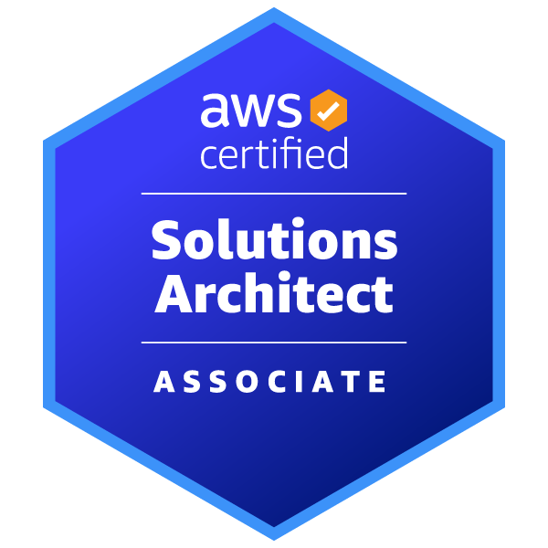
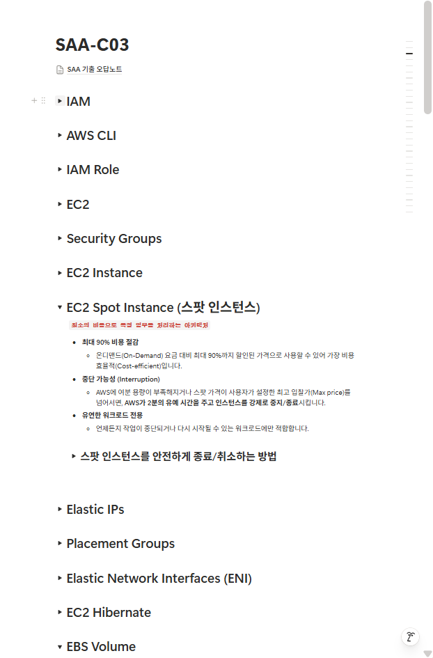
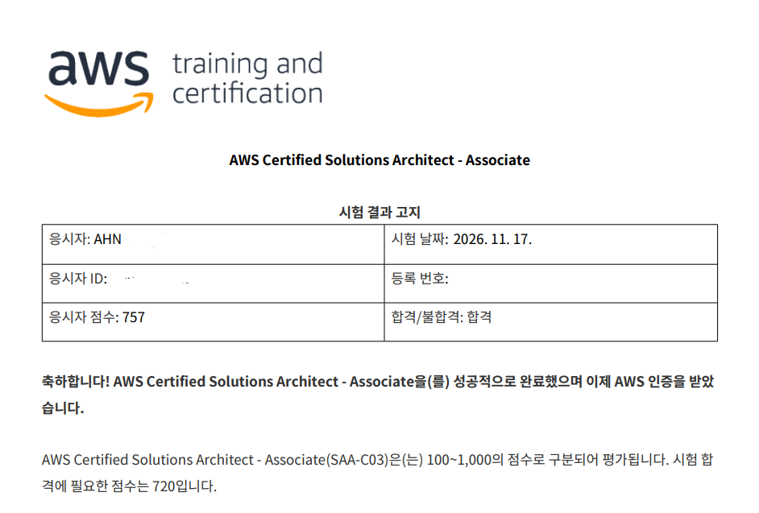

{: width="30%"}

## SAA-C03 준비
클라우드 공부할 겸 AWS 자격증 중 가장 많이들 도전하는 SAA-C03에 도전했다.

>AWS Well-Architected Framework를 기반으로 보안, 복원력, 성능, 비용 최적화를 고려한 클라우드 아키텍처 설계 역량을 검증하는 자격증입니다

AWS는 기본적인 기능만 사용해봤고, CloudGoat, flaw.cloud 같은 워게임을 풀면서 보안 도메인 조금 알고 있는 수준이었다.

### 가격
AWS SAA-C03 가격은 **150$** 지만, 연말에 보통 반값 바우처를 뿌린다. 나도 이번에 <https://www.pearsonvue.com/> 에서 진행하는 프로모션 기회가 있어서 도전하게 됐다. 프로모션은 **첫 시험 + 재시험 기회** 포함 **75$**였다. 그래도 한화로 11만원 정도 했기 때문에 일단 지르고, 돈 아까워서 강제로 공부하는 방법을 택했다.

### 공부 기간
바우처가 11/17까지 유효기간이라 얼마 남지 않아 바로 지원했다.

결제 11/6, 시험은 11/17 로 열흘 밖에 공부 기간이 없었다.

### 공부 방법
앞서 말했듯이 AWS 경험이 많지 않기 때문에 그동안 어렴풋이 알고 있던 내용을 다시 정리하는 데에 일주일 정도 썼다.

<https://velog.io/@gagaeun/AWS-IAM> 보면서 노션에 정리하면서 공부했다.

정리 중에도 노션과 AI를 계속 사용하면서, 시험에 자주 나오는 포인트와 내가 헷갈리는 부분을 이해하기 쉽게 정리했다.

개념 정리를 마치고 5일은 덤프 문제만 주구장창 풀었다. 500문제 정도 되는 덤프 문제를 풀면서 계속 반타작하길래 자신감이 점점 떨어져갔다...

처음 계획은 덤프를 빨리 풀고 두 바퀴는 돌려보고 응시할 생각이였지만, 생각보다 어렵고 시간이 오래 걸려서 오답노트만 한바퀴 겨우겨우 보고 응시했다.

### 온라인 시험

AWS 시험은 오프라인과 온라인을 모두 지원한다.

나는 가장 가까운 강남 시험장까지 한시간은 걸리는 위치기 때문에, 집에서 보려고 **온라인 시험으로 오전 8시**에 신청했다. (남은 날 중에는 딱 하루 10시20분 빼고는 오전8시 밖에 없었다)

이미 신청하고 나서 지인한테 물어봤더니 온라인 시험은 환경 빡세게 잡아서 귀찮아진다고 하더라... 곧장 다른 후기 찾아보니 네트워크나 주변 환경 때문에 못본 사람들도 있었다

내 방은 책장이나, 각종 전자기기가 많기 때문에 오해사기 십상이었다.

급하게 근처 깔끔한 스터디룸을 빌려서 시험에 응시했다.

### 준비물
- 외국 시험이기 때문에 **여권**을 추천한다. 오프라인 온라인 모두 **주민등록증 또는 운전면허증과 여권(필수) 2개**를 모두 챙기는걸 추천한다.
- 노트북에 미리 **응시 프로그램** 설치하고, 캠,마이크,네트워크,실행 프로세스 등을 점검해야한다.
- 시험 문제는 한국어로 나오지만, **감독관은 외국인**이다. 나는 인도 영어를 구사하는 감독관이 진행해주셨는데, 도무지 알아듣지 못해 의사소통의 문제로 땀 좀 흘렸다.
- 감독관의 지시대로 방 안 전체를 캠으로 보여주고, 이상이 없는지 확인한다. 손목시계, 책상 위 물건 등도 꼼꼼하게 확인한다.

(어찌저찌 시험은 봤지만, 다른 AWS자격증은 마음 편하게 오프라인으로 응시할 것 같다.)

### 턱걸이 합격 👌

준비 기간이 짧았지만 겨우겨우 턱걸이했다! (두 문제 차이)

덤프 문제보다는 전반적으로 쉬웠다. 덤프는 문제만 5~6줄 되는 문제들이 태반이였는데, 본 시험은 두세 줄의 짧은 문제가 대부분이었다. 운이 좋았다.

### 다음 목표

AWS 아키텍쳐에 대해 공부할 수 있는 좋은 자격증이라고 생각한다. 턱걸이로 통과한거라 더 복습해야겠다.

다음은 시간 날 때 AWS Certified Security - Specialty(**SCS-C03**)에 응시해 봐야겠다.

다른 분들 후기는 SAA-C03과 비슷한 내용에서 보안 도메인을 심화한 느낌이라고 한다.

SCS-C03은 시험비만 300$라고 하니까, 충분히 준비해서 응시해야지.
이번 시험 보고 AWS에서 50% 쿠폰을 줬어도 20만원이 넘네😂